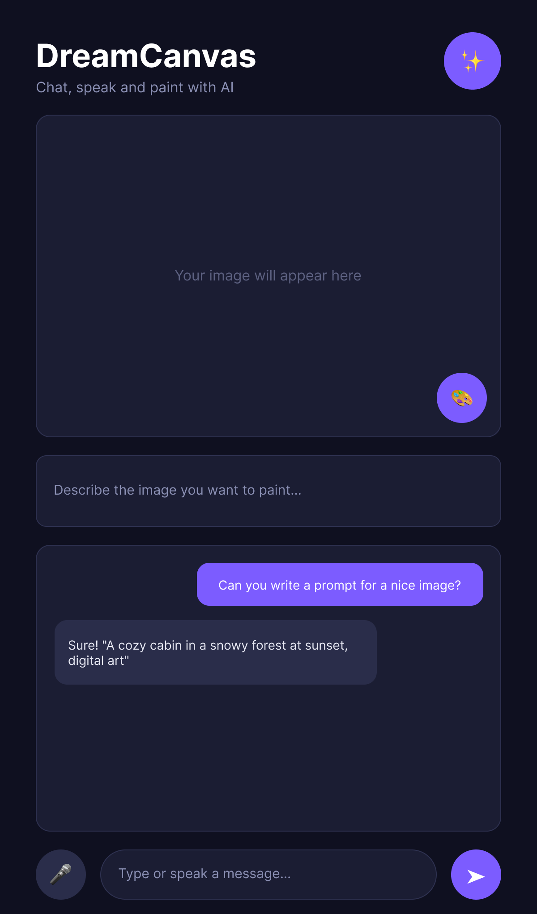

# Mini Project 3 – DreamCanvas

A simple chatbot web app: talk to the chatbot with your voice and let it help you create a digital image.

- **Figma design:** (https://www.figma.com/design/le7K4IHuoByzfsjBU14JpZ/DreamCanvas-%E2%80%93-Mini-Project-3?node-id=0-1)
- **Backend:** Flask (`app.py`) + three AI models (`models.py`), all running locally on the GPU
- **Frontend:** HTML / CSS / JavaScript (`templates/index.html`, `static/`), built from the Figma design



## Features

1. **Image generation** – write a prompt and press 🎨; the image appears in the image box.
2. **Voice chat** – press 🎤, speak, press 🎤 again; the text appears in the message box.
   Press ➤ (or Enter) to send it; the user message and the chatbot's reply appear in the chat history.
   Under each reply, *Use as prompt* copies the suggested prompt into the prompt box.

| Part | Model | Class in `models.py` |
|---|---|---|
| Speech-to-text | `openai/whisper-large-v3` | `SpeechToText` |
| Chatbot | `HuggingFaceTB/SmolLM2-360M-Instruct` | `ChatBot` |
| Text-to-image | `stabilityai/sd-turbo` (1 step, 512×512) | `ImageGenerator` |

## API

| Method | URL | Body | Answer |
|---|---|---|---|
| GET | `/` | – | the web page |
| POST | `/api/transcribe` | form-data `audio` (WAV file) | `{"text": "..."}` |
| POST | `/api/chat` | `{"messages": [{"role": "user", "content": "..."}]}` | `{"reply": "..."}` |
| POST | `/api/generate-image` | `{"prompt": "..."}` | `{"image": "data:image/png;base64,...", "seconds": 0.4}` |

The browser records the microphone itself and sends a 16 kHz WAV file, so no ffmpeg is needed.

## Run

```powershell
pip install -r requirements.txt     # install torch with CUDA first
python download_models.py           # SmolLM2 Instruct + SD-Turbo (~3.2 GB); Whisper is downloaded on first start
python app.py                       # open http://127.0.0.1:5000
```

Version notes: `transformers<5` and `diffusers<0.40` both work with `huggingface_hub` 0.x.
All three models together need about 7 GB of GPU memory (tested on an RTX 5070 Ti Laptop GPU).
