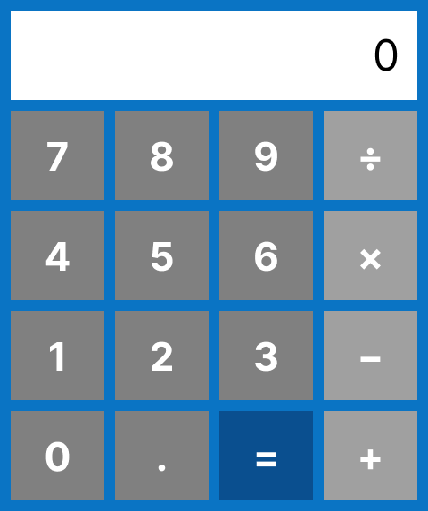
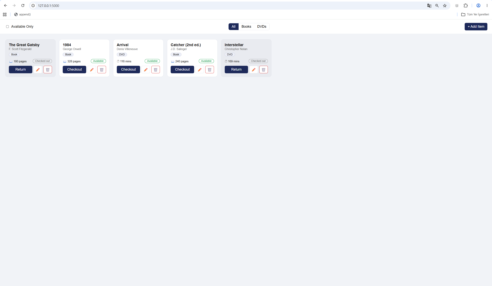

# Week 4

## Section 1 – Calculator Design


Figma (view-only): https://www.figma.com/design/xoc1Wsq8nSrixMhQKCe4IH/EE471-Week4-Calculator?node-id=0-1&t=32nimhEiecWQn7Ey-1

## Section 1 – How to run
```
cd Week4/calculator
pip install flask
python app.py
```
Open http://127.0.0.1:5000 in the browser.

API tests: `calculator/tests.http` (VSCode REST Client extension)

## Section 2 – Library App

```
cd Week4/library
pip install -r requirements.txt
python app.py
```
Open http://127.0.0.1:5000 in the browser.

- Model: `library/custom_classes.py` (all rules)
- API: `library/app.py` (HTTP → method calls only)
- Tests: `python run_tests.py` (runs all 24 endpoint tests while the server is running) or `library/tests.http`